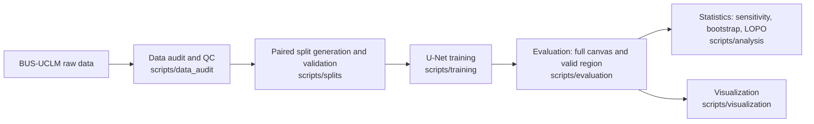

# Patient-Level vs Image-Level Data Splitting in Breast Ultrasound Lesion Segmentation

Code and experimental workflow for a paired study of how the **unit of data
partitioning** (image-level vs patient-level) affects breast ultrasound (BUS)
lesion segmentation and **false-positive predictions on normal images**, using the
BUS-UCLM dataset and a U-Net.


> **Manuscript:** *Effect of Patient-Level versus Image-Level Data Splitting on Breast Ultrasound Lesion Segmentation and Normal-Image False Positives: A Paired Evaluation on the BUS-UCLM Dataset* (in preparation)
> **Dataset:** BUS-UCLM (not included in this repository; see [Data access](#data-access))

---

## At a glance

| | |
|---|---|
| **Question** | Does splitting by image vs by patient change lesion overlap (Dice, IoU) and normal-image false positives? |
| **Design** | 5 paired splits (seeds `42, 123, 2025, 7, 99`); identical validation and test images for both strategies; matched training-set size and class composition |
| **Model** | Standard U-Net (16-32-64-128 encoder, 256 bottleneck), 256 × 256 input |
| **Data** | 670 image-mask pairs from 37 patients (170 benign, 90 malignant, 410 normal) after quality control |
| **Analyses** | Full-canvas and valid-region evaluation, aggregation sensitivity, patient-level bootstrap (10,000 replicates), leave-one-patient-out |

### Key findings

| Finding | Detail |
|---|---|
| Lesion overlap | No consistent winner: image-level was higher for Dice/IoU in 3 of 5 splits, patient-level in 2 |
| Aggregation matters | The sign of the pooled Dice/IoU difference changed with the weighting scheme (per seed, per patient, per unique image) |
| Normal-image false positives | Patient-level splitting was associated with higher FP measures in 4 of 5 splits, under all aggregation schemes and in every leave-one-patient-out iteration |
| Bootstrap (patient-level) | FP area-fraction difference excluded zero (+0.048, 95% CI 0.022 to 0.076); Dice, IoU and FP image rate intervals included zero |
| Valid-region analysis | Same pattern as the full-canvas evaluation |

These results are specific to this dataset, model and setup. They are **not** a universal
ranking of splitting strategies. Absolute performance is modest (short training, small
U-Net), so interpret results as relative comparisons.

---

## Contents

- [Quick start](#quick-start)
- [Study design](#study-design)
- [Model and training](#model-and-training)
- [Evaluation](#evaluation)
- [Repository structure](#repository-structure)
- [Reproduction workflow](#reproduction-workflow)
- [Environment setup](#environment-setup)
- [Data access](#data-access)
- [Data and output policy](#data-and-output-policy)
- [Reproducibility checklist](#reproducibility-checklist)
- [Known caveats](#known-caveats)
- [Citation](#citation)
- [License](#license)

---

## Quick start

Commands are for Windows PowerShell and run from the repository root.

```powershell
# 1. Environment
py -3.12 -m venv .venv
.\.venv\Scripts\python.exe -m pip install --upgrade pip
.\.venv\Scripts\python.exe -m pip install -r requirements.txt

# 2. Place BUS-UCLM locally (see "Data access"), then validate the existing paired splits
.\.venv\Scripts\python.exe scripts\splits\validate_paired_splits_independent.py

# 3. Evaluate trained checkpoints (full canvas + valid-region sensitivity)
.\.venv\Scripts\python.exe scripts\evaluation\evaluate_paired_test.py
.\.venv\Scripts\python.exe scripts\evaluation\evaluate_paired_test_valid_region.py

# 4. Statistical and patient-aware analyses
.\.venv\Scripts\python.exe scripts\analysis\sensitivity_analysis.py
.\.venv\Scripts\python.exe scripts\analysis\bootstrap_patient_analysis.py
.\.venv\Scripts\python.exe scripts\analysis\leave_one_patient_out.py
```

> **Before running anything:** check each script's configured input and output paths.
> Some scripts create or overwrite split CSVs, manifests, reports, checkpoints or results.
> **Back up existing artifacts first**, and do not rerun split generation or training over
> completed experiments unless replacement is intended.

### Pipeline overview



---

## Study design

### Dataset

BUS-UCLM originally contains 683 images from 38 patients. After quality control,
13 image-mask pairs with unresolved spatial-dimension mismatches were excluded.

| Category | Images |
|---|---:|
| Benign | 170 |
| Malignant | 90 |
| Normal | 410 |
| **Total** | **670** |

Normal images have empty lesion masks. Patient identifiers are retained for patient-level
splitting and patient-aware analyses.

### Paired splits

For each seed, both strategies share exactly the same validation and test images:

| Partition | Benign | Malignant | Normal | Total |
|---|---:|---:|---:|---:|
| Validation | 26 | 12 | 62 | 100 |
| Test | 31 | 14 | 61 | 106 |

| Strategy | Definition |
|---|---|
| **Patient-level** | All images from patients assigned to validation or test are excluded from training. |
| **Image-level** | Same validation and test images, but other images from those held-out patients may remain in training. Extra training images are drawn from other patients to match the patient-level training set's size and class composition. |

The image-level condition is therefore a *controlled leakage setting*, not an
unconstrained random image split.

The split-validation workflow checks paired validation/test filenames, training-set size
and class balance, and the intended patient-overlap properties.

> **The five test configurations are not independent cohorts.** Some patients appear in more
> than one seed. Seed-level comparisons are therefore treated descriptively, with
> patient-aware aggregation and sensitivity analyses.

---

## Model and training

A standard U-Net for binary lesion segmentation: RGB input, one-channel logits; encoder
channels 16/32/64/128; 256-channel bottleneck; double-convolution blocks with batch
normalisation and ReLU; max pooling in the encoder; transposed convolutions and skip
connections in the decoder.

| Setting | Value |
|---|---|
| Input size | 256 × 256 (aspect ratio preserved, centre-padded) |
| Image interpolation / padding | Bilinear / replicate |
| Mask interpolation / padding | Nearest-neighbour / constant zero |
| Intensity scaling | `[0, 1]` (divide by 255) |
| Batch size | 4 |
| Maximum epochs | 10 |
| Optimiser | Adam, learning rate 0.001, weight decay 0.0001 |
| Loss | 0.5 × BCE-with-logits + 0.5 × Dice loss |
| Positive-class weight (BCE) | 5 |
| Mixed precision | Enabled for CUDA |
| Checkpoint selection | Highest validation lesion macro-Dice at threshold 0.5 |
| Early-stopping patience | 10 epochs (see [Known caveats](#known-caveats)) |
| Data augmentation | None |
| Test threshold | Fixed at **0.5**; never tuned on the test set |

---

## Evaluation

### Primary metrics (full 256 × 256 canvas, including padding)

| Subset | Metric | Meaning |
|---|---|---|
| Benign + malignant | Lesion macro-Dice, macro-IoU, pixel recall | Per-image values averaged over lesion test images |
| Normal | **FP image rate** | Proportion of normal images with at least one predicted positive pixel |
| Normal | **FP area fraction** | Mean fraction of pixels predicted positive across normal images |

### Sensitivity and patient-aware analyses

1. **Valid-region evaluation:** recomputes metrics inside the resized source-image region only
   (excluding padding) and quantifies predictions falling in padding separately.
2. **Aggregation sensitivity:** equal weight per seed, per unique patient, per unique test image.
3. **Patient-level bootstrap:** resamples unique patients with replacement (10,000 replicates);
   percentile 95% confidence intervals.
4. **Leave-one-patient-out (LOPO):** repeats the paired comparison after excluding each patient.

The bootstrap "proportion of positive differences" is **descriptive, not a p-value**. No
conventional independent-samples test is applied to the five seed-level comparisons.

---

## Repository structure

Intended high-level layout. Local data, checkpoints, generated results and the virtual
environment stay on the development machine and are not meant to be committed.

```text
medical-segmentation-paper/
├── configs/
│   └── unet.yaml
├── data/
│   ├── raw/                 # Local dataset; do not commit
│   └── processed/           # Local metadata and split files
├── docs/
│   ├── dependency_report.txt
│   └── project_structure.txt
├── experiments/
├── notebooks/
├── paper/
├── results/                 # Local checkpoints and generated outputs
├── scripts/
│   ├── analysis/            # Statistical, patient-aware and model diagnostics
│   ├── data_audit/          # Dataset and mask quality-control scripts
│   ├── diagnostics/         # Environment and path diagnostics
│   ├── evaluation/          # Full-canvas and valid-region evaluation
│   ├── splits/              # Split generation and validation
│   ├── training/            # Model training scripts
│   └── visualization/       # Dataset, prediction and error visualizations
├── src/
│   ├── datasets/
│   └── models/
├── tests/
├── README.md
├── requirements.txt
└── .gitignore
```

| Directory | Purpose |
|---|---|
| `scripts/data_audit/` | Inspect metadata, image-mask pairs, dimensions, masks, labels and patient distribution |
| `scripts/splits/` | Create, search and validate image-level, patient-level and paired splits |
| `scripts/training/` | Train U-Net models and run training comparisons |
| `scripts/evaluation/` | Evaluate checkpoints and paired test sets (full canvas and valid region) |
| `scripts/analysis/` | Statistical, patient-aware, probability, false-positive and BatchNorm analyses |
| `scripts/visualization/` | Dataset samples, predictions, errors and paired comparisons |
| `scripts/diagnostics/` | Project paths, GPU availability, batch-size behaviour |
| `src/` | Reusable dataset, preprocessing and model code |
| `tests/` | Tests for configuration, dataset, preprocessing, splits and model definitions |
| `configs/` | Experiment configuration |
| `docs/` | Project structure and dependency reports |

---

## Reproduction workflow

### 1. Dataset preparation and quality control

Scripts in `scripts/data_audit/`: `inspect_dataset.py`, `validate_dataset.py`,
`analyze_masks.py`, `inspect_mismatches.py`, `review_mask_samples.py`. They check
image-mask consistency, class distribution, empty masks, mask geometry and visual
examples. The final dataset excludes the 13 pairs with unresolved dimension mismatches.

```powershell
.\.venv\Scripts\python.exe scripts\data_audit\inspect_dataset.py
```

### 2. Construct and validate paired splits

```powershell
.\.venv\Scripts\python.exe scripts\splits\search_paired_split_candidates.py
.\.venv\Scripts\python.exe scripts\splits\create_paired_splits.py
.\.venv\Scripts\python.exe scripts\splits\validate_paired_splits_independent.py
```

Outputs are written to `data/processed/paired_splits/` (patient-level and image-level CSVs
per seed, plus validation and manifest reports). **The generator can overwrite existing
split files**, so back them up before regenerating. Run the independent validator and
review its output before training.

### 3. Train U-Net models

Training script: `scripts/training/train_unet.py`. It locates the project root automatically
(the first parent folder containing `configs/`, `src/` and `requirements.txt`), so it can be
run from any working directory, but run from the repository root for consistent relative paths.

| Argument | Required | Default | Description |
|---|---|---|---|
| `--split-csv` | yes | none | Split CSV with `train` and `val` partitions (relative paths resolve from the project root) |
| `--output-dir` | yes | none | Output folder for `best_model.pt` and `training_log.csv` |
| `--seed` | no | `experiment.seed` in the config | Random seed |
| `--config` | no | `configs/unet.yaml` | YAML config (image size, batch size, epochs, loss weights, learning rate, etc.) |
| `--epochs` | no | `training.epochs` in the config | Overrides the epoch count |
| `--padding` | no | `replicate` | `replicate` or `constant` image padding. The study used the default |
| `--model` | no | `unet` | `unet` or `attention_unet`. The study used `unet` |

Train one model for every seed and split condition. Replace the CSV filename pattern with the
actual files in `data/processed/paired_splits/`:

```powershell
$seeds = 42, 123, 2025, 7, 99
foreach ($seed in $seeds) {
    foreach ($split in "image", "patient") {
        .\.venv\Scripts\python.exe scripts\training\train_unet.py `
            --split-csv "data\processed\paired_splits\<your-${split}-split-file-for-seed-${seed}>.csv" `
            --seed $seed `
            --output-dir "results\paired_full_${split}_${seed}"
    }
}
```

Run a single model, for example:

```powershell
.\.venv\Scripts\python.exe scripts\training\train_unet.py `
    --split-csv data\processed\paired_splits\<split-file>.csv `
    --seed 42 `
    --output-dir results\paired_full_patient_42
```

Each run writes to `--output-dir`:

| File | Content |
|---|---|
| `best_model.pt` | Checkpoint with the highest validation lesion macro-Dice at threshold 0.5 (also stores epoch, config, seed, split CSV, padding mode and selection rule) |
| `training_log.csv` | Per epoch: train loss, validation loss, validation lesion Dice and normal FP rate at 0.5, image counts, epoch time |

The evaluation scripts expect checkpoints at:

```text
results/paired_full_{image|patient}_{seed}/best_model.pt
```

where `{seed}` is one of `42`, `123`, `2025`, `7`, `99`.

**Safety behaviour:** the trainer raises `FileExistsError` if `best_model.pt` already exists in
the chosen `--output-dir`, so it will not overwrite a finished run. Choose a new folder to retrain.

Training uses a fixed seed for Python, NumPy and PyTorch, deterministic cuDNN, and a seeded
DataLoader generator. Validation reports lesion macro-Dice and the normal-image FP rate at
0.5; only the Dice is used for checkpoint selection.

`train_unet_save_epochs.py` is a variant that also saves per-epoch checkpoints for epoch
diagnostics. Its output layout differs from the standard trainer unless paths are configured
consistently.

Training can take substantial GPU time. Confirm the config, split CSV and output path before
starting.

### 4. Evaluate paired test sets

```powershell
.\.venv\Scripts\python.exe scripts\evaluation\evaluate_paired_test.py
.\.venv\Scripts\python.exe scripts\evaluation\evaluate_paired_test_valid_region.py
```

| Evaluator | Per-image output |
|---|---|
| Full canvas | `results/test_evaluation/test_per_image_metrics.csv` |
| Valid region | `results/test_evaluation_valid_region/test_per_image_metrics_valid_region.csv` |

Both use a fixed threshold of 0.5 and also write summary and paired-comparison CSVs in their
configured output directories.

### 5. Statistical and sensitivity analyses

```powershell
.\.venv\Scripts\python.exe scripts\analysis\sensitivity_analysis.py
.\.venv\Scripts\python.exe scripts\analysis\bootstrap_patient_analysis.py
.\.venv\Scripts\python.exe scripts\analysis\leave_one_patient_out.py
```

These read the **full-canvas** file `results/test_evaluation/test_per_image_metrics.csv`.
They do **not** analyse valid-region metrics unless their input paths are changed.
Other analysis scripts (validation thresholds, prediction probabilities, preprocessing,
BatchNorm behaviour, influential patients, individual errors) are supplementary and not
required for the primary paired comparison.

### 6. Visualize errors

`scripts/visualization/visualize_test_errors.py` reads
`results/test_evaluation/test_per_image.csv`, a **different file** from the evaluator's
`test_per_image_metrics.csv`, and expects its configured checkpoint to exist. Confirm both
are present first. Other visualization scripts may need specific checkpoints or
intermediate results; check their configured paths.

---

## Environment setup

Developed with Python 3.12, PyTorch and CUDA.

```powershell
py -3.12 -m venv .venv
.\.venv\Scripts\Activate.ps1
python -m pip install --upgrade pip
pip install -r requirements.txt
```

If PowerShell blocks activation, call the environment's interpreter directly:

```powershell
.\.venv\Scripts\python.exe -m pip install --upgrade pip
.\.venv\Scripts\python.exe -m pip install -r requirements.txt
```

Install a PyTorch build matching your OS, NVIDIA driver and CUDA runtime using the official
PyTorch selector. Development used `torch 2.11.0+cu128`; this exact build may not suit every
machine. Verify the install:

```powershell
.\.venv\Scripts\python.exe -c "import torch; print(torch.__version__); print(torch.cuda.is_available())"
```

---

## Data access

The dataset is **not included**. Obtain BUS-UCLM from its official publication/repository
([Vallez et al., *Scientific Data* 2025](https://doi.org/10.1038/s41597-025-04562-3)),
follow its license and citation requirements, and place it under `data/raw/` (or update the
relevant path configuration). Never commit raw data or patient information to Git.

## Data and output policy

The repository should contain code, configuration, documentation and, where appropriate,
small split-definition and manifest files. It should **not** contain:

- raw BUS-UCLM images or masks;
- virtual environments (`.venv/`);
- model checkpoints (`.pt`, `.pth`);
- large result directories or temporary logs;
- `__pycache__/` and `*.pyc`;
- IDE-specific settings.

Before publishing, review `git status` and confirm that no raw data, checkpoints, local
environment files, private metadata or restricted artifacts are staged.

---

## Reproducibility checklist

- [ ] Same paired validation and test images for both strategies
- [ ] Matched training-set size and class composition
- [ ] Fixed threshold of 0.5 for test evaluation
- [ ] Five seeds **not** treated as five independent patient cohorts
- [ ] Full-canvas primary metrics kept distinct from valid-region sensitivity metrics
- [ ] Statistical scripts pointed at the intended per-image metrics file
- [ ] Python, PyTorch, CUDA and dependency versions recorded for each reproduction
- [ ] Original split manifests, reports and checkpoints preserved for each completed experiment

## Known caveats

- **Early stopping:** patience is 10 epochs and the maximum is also 10. Because the first epoch
  always counts as an improvement, early stopping cannot trigger and all models train for the
  full 10 epochs.
- **Mixed precision:** the trainer uses `autocast` on CUDA without a gradient scaler.
- **Modest absolute performance:** small U-Net, short training, no augmentation. Several
  normal-image FP rates are high, possibly influenced by the BCE positive-class weight of 5.
  Treat findings as relative differences between strategies.
- **One model per strategy per seed:** split composition and training randomness are
  confounded, and the bootstrap does not capture training variability.
- **Single dataset, single architecture:** results may not transfer to other datasets,
  models or loss functions.

---

## Citation

If you use this repository or reproduce the experiments, please cite the associated
manuscript once published (currently in preparation) and the dataset paper:

> Vallez N, Bueno G, Deniz O, et al. BUS-UCLM: Breast ultrasound lesion segmentation
> dataset. *Scientific Data*. 2025;12:242. https://doi.org/10.1038/s41597-025-04562-3

The U-Net architecture follows:

> Ronneberger O, Fischer P, Brox T. U-Net: Convolutional networks for biomedical image
> segmentation. MICCAI 2015. https://doi.org/10.1007/978-3-319-24574-4_28

## License

**This repository does not yet have a license.** Until one is added, the code is under default
copyright (all rights reserved), which means others may view it but do not have permission to
reuse, modify or redistribute it. A license will be added before or alongside publication of the
associated manuscript.

The BUS-UCLM dataset is not included and is governed by its own license and terms of use.
The dataset license and any future code license are separate.
